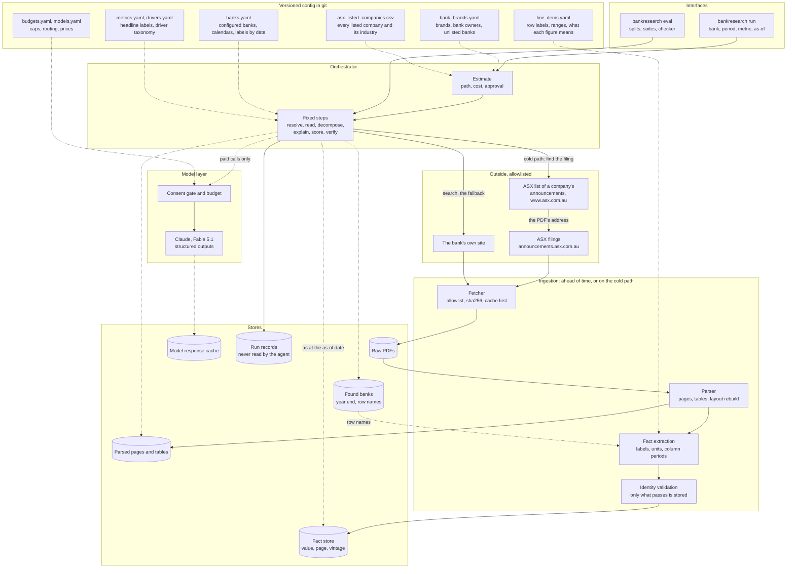
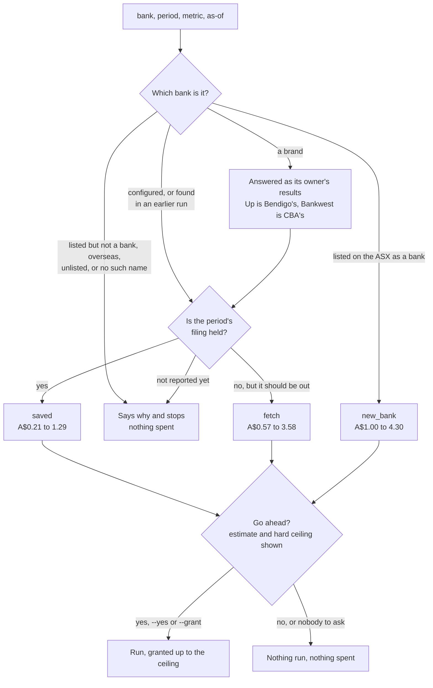
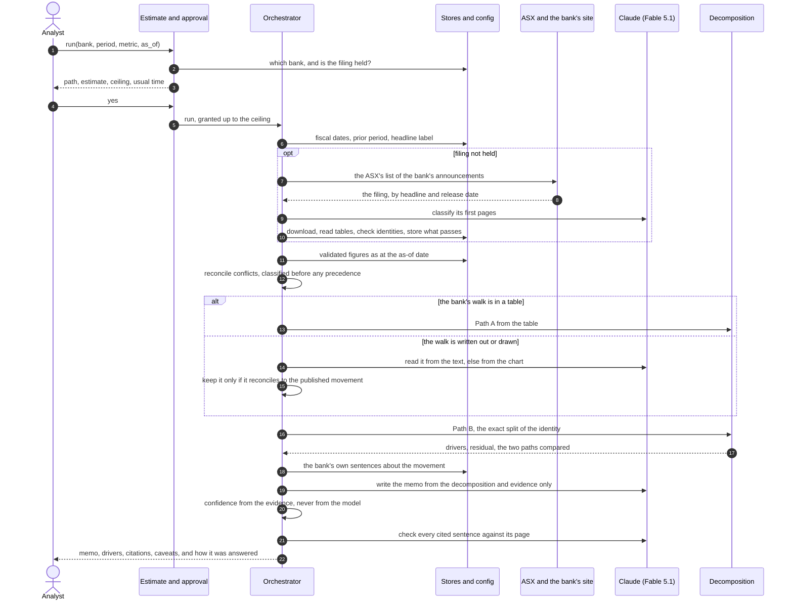
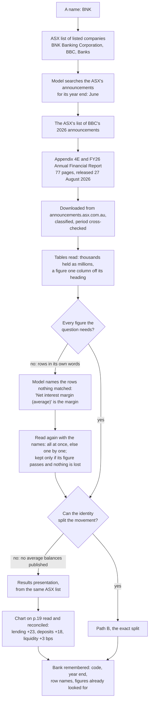
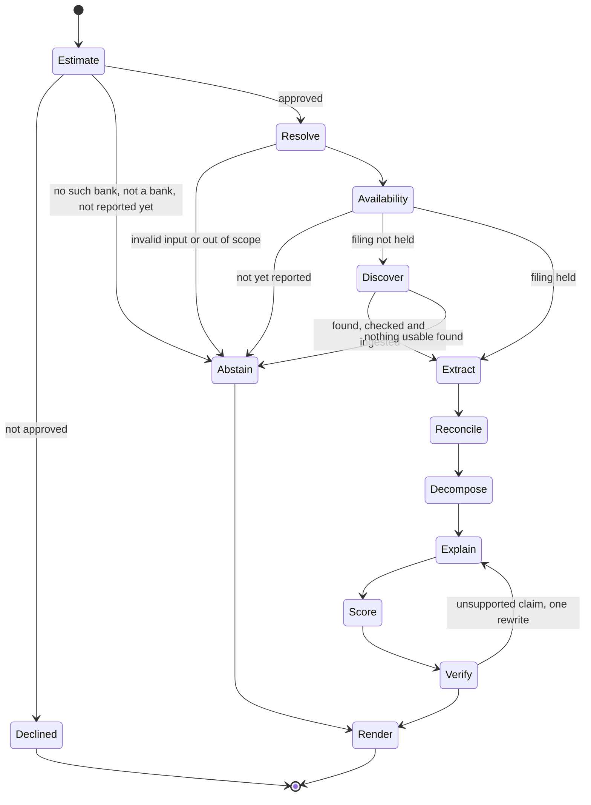
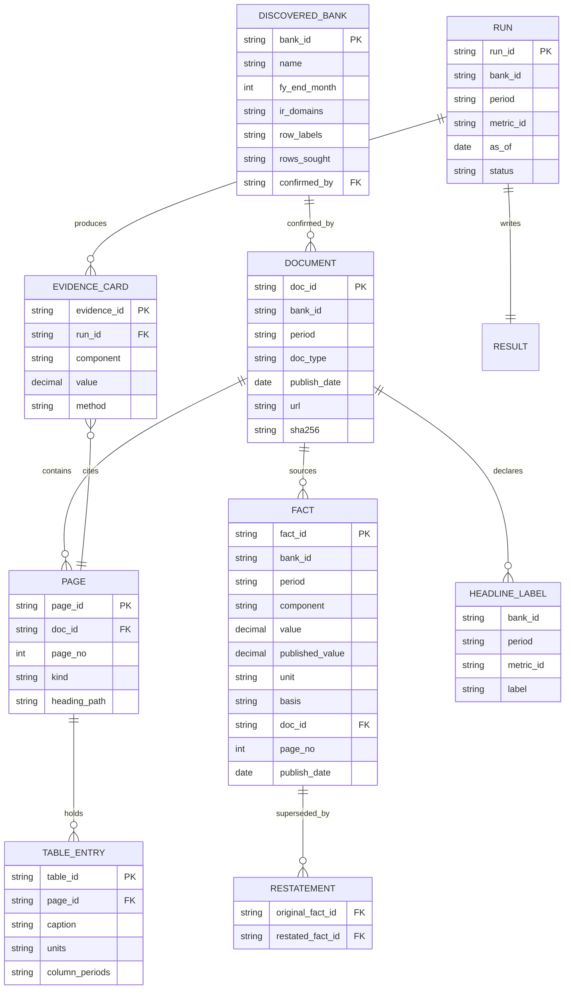

# Design

## Executive summary

This document describes how Equity Researcher is built and records the decisions behind it.
The first part shows the architecture in six diagrams. The second part is a set of 74
decision records, one paragraph each.

The design separates deterministic code from model calls. Code resolves the question,
extracts and validates every figure, settles disagreements between sources, attributes the
movement and scores confidence. A language model finds and reads filings, reads the bank's
own walk when it is written as prose or drawn as a chart, writes the memo, and checks each
cited sentence against its source. The agent estimates what a question will cost before any
model call is made, and every call passes through a consent gate.

Ingestion parses each filing into an outline, page text and a register of tables. Validated
figures go into a SQLite fact store with their basis, source page and publication date.
Each run's result, memo and trace are written to `runs/`, and a response cache replays
identical model requests.

**The six diagrams**

| Diagram | What it shows |
| --- | --- |
| 1. Components and data flow | The packages, the stores they read and write, and where the consent gate sits |
| 2. Before anything is spent | How a question is classified (held, to be fetched, not yet reported, a brand, a new bank) and what the estimate reports before asking for approval |
| 3. One question, end to end | The steps and calls for a single question, from resolving the period to rendering the answer |
| 4. A bank nobody has read | The live run on BNK Banking Corporation, from finding the bank on the ASX to answering from its own filings |
| 5. Agent state machine | The fixed order of steps, and where a run can abstain or stop |
| 6. Stored data | The records the agent keeps and how they relate, including how a restatement sits beside the original figure |

**The decision records**

The records are numbered in the order the decisions were made, and the code cites them by
number. A later record can replace an earlier one: ADR-041 superseded ADR-031 when every
model step moved to Claude Fable 5.1. By topic:

| Topic | Records |
| --- | --- |
| Arithmetic and attribution | ADR-001, ADR-005, ADR-007, ADR-008, ADR-009, ADR-022, ADR-023, ADR-038, ADR-052, ADR-053, ADR-062 |
| Reading tables and figures | ADR-011, ADR-013, ADR-014, ADR-015, ADR-016, ADR-019, ADR-020, ADR-021, ADR-037, ADR-039, ADR-046, ADR-049, ADR-050, ADR-051, ADR-060, ADR-061 |
| Finding filings and banks | ADR-006, ADR-036, ADR-040, ADR-058, ADR-059, ADR-063, ADR-065, ADR-066, ADR-067, ADR-073 |
| Retrieval and context | ADR-027, ADR-030, ADR-032, ADR-033, ADR-034, ADR-042, ADR-043 |
| Model use, the memo and its checks | ADR-024, ADR-031, ADR-035, ADR-041, ADR-044, ADR-048, ADR-056, ADR-064, ADR-068, ADR-070, ADR-071, ADR-074 |
| Conflicts and confidence | ADR-026, ADR-029, ADR-047, ADR-054, ADR-055, ADR-069, ADR-072 |
| Evaluation | ADR-017, ADR-025, ADR-028, ADR-045, ADR-057 |
| Tooling and scope | ADR-002, ADR-003, ADR-004, ADR-010, ADR-012, ADR-018 |

## Architecture

### 1. Components and data flow

The stores are filled by ingestion, ahead of time for the configured corpus and on the cold
path for anything else. At question time the orchestrator reads them as at the question's
as-of date, and every paid call goes through the consent gate.

### 2. Before anything is spent: the estimate

Every answer is written and checked by a model, so every question costs something. The
estimate says which path it is, what's held, what will be fetched, what it should cost and
how long it usually takes, and the approved ceiling becomes the run's grant (ADR-064).

### 3. One question, end to end

The model proposes; code executes. Extraction from tables is deterministic, the page search
only runs when ranking finds no page that could hold the walk (ADR-034), and a figure never
passes through the model to be copied.

### 4. A bank nobody has read

This is the live run on BNK Banking Corporation, step by step (ADR-063, ADR-065 and
ADR-066). The next question about BNK starts from what was remembered and searches for
nothing.

### 5. Agent state machine

Every path that runs ends in Render, so an abstention still produces a result that says why.
For a bank nobody configured, Extract also matches its own row names and fetches its slide
pack when the filing can't split the movement. A model that can't be used at all (no key, a
refused key, no credit, a service that stays down) stops the run wherever it happens, with
the reason and what to do about it (ADR-070).

### 6. Stored data

Facts keep their vintage, so a restatement adds a row and never overwrites one. A found bank
keeps facts about itself (its year end, the names it gives its rows, the figures already
looked for in each filing) and never a conclusion. Runs and evidence cards live in `runs/`,
outside the database the agent reads. The model response cache sits beside these and only
ever replays an identical request.

---

## Decision records

One paragraph each: what was decided, and why. The numbers are stable, because the code
cites them.

### ADR-001: Exact rational arithmetic inside the decomposition engine

The Shapley split and the ratio and weighted-average splits work in Python's `Fraction`, and
convert to `Decimal` only for storage and display. Path B rests on the drivers adding up to
the movement exactly, so that's tested as exact equality, in a property test over 200
generated cases, rather than as a difference within some slack.

### ADR-002: Python 3.13 rather than 3.12

Developed on 3.13. Nothing in the stack needs a particular version, so CI runs every test on
3.12, 3.13 and 3.14, and `make setup` accepts any of them.

### ADR-003: pip and venv rather than uv

`python -m venv` and `pip install -e`, with every version pinned in `constraints.txt`
(`make lock` re-pins them). uv wasn't installed where this was built, the dependency set is
small, and the deterministic core has no native dependencies, so a second packaging tool
would add a step without adding reproducibility the pins don't already give.

### ADR-004: Config carries an explicit verification status

Every config fact that has to be checked against a source (a year end, a release month, a
price) carries a status, a `verified` entry names its `source_url`, and
`bankresearch config-check` fails while any field is still `unverified`. A wrong year end
gives confident arithmetic about the wrong six months and nothing downstream notices, so the
gap has to be visible to a machine.

### ADR-005: Aggregate driver nodes for undisclosed splits

Where a bank doesn't disclose a finer split, the movement goes to an aggregate node rather
than to an invented cause: `earn.nii`, `cet1.capital`, `cet1.rwa` and `cic.collective`, and
for the margin identity, `nim.income` and `nim.balance_growth`. `earn.nii` is also the parent
of the three net interest income lines. These ids are structural, claim nothing about
causes, and are held below High (ADR-072). Naming a cause the bank never disclosed is the worst
mistake an attribution can make, because the number is right and nothing later notices the
cause was made up. The two margin nodes have no synonyms on purpose: a bar labelled "net
interest income" belongs to an earnings walk, and mapping it here would let an income walk
pass for a margin breakdown.

### ADR-006: The as-of default is derived from the configured release month

With no `--as-of`, a question is answered as at the last day of the month the bank releases
that kind of result (`results_release_months` in `config/banks.yaml`); a second half uses the
full-year month, since 2H figures are published inside the full-year result. A month end
leans toward including the document the question is about, which avoids a false
`PERIOD_NOT_YET_REPORTED`. `--as-of` overrides it, and `--as-of today` allows later vintages.

### ADR-007: Taxonomy mapping in the decomposition layer is deterministic only

`decomposition/taxonomy.py` matches labels by exact normalised synonym and nothing else, and
returns what it couldn't map. A model's mapping happens in the agent layer, which passes
already-mapped labels in. That keeps the package that must never be wrong free of a network
dependency.

### ADR-008: The ROE equity effect is not split

The equity effect is one figure; where buybacks, retained earnings or DRP are disclosed, a
note says so. Drivers are scored by matching canonical ids, so an invented id would make the
output look richer and measure worse. Four taxonomy entries would make the split exact, since
the arithmetic is already linear in the equity movement.

### ADR-009: NIM Path B claims no driver without divisional data

With divisional weights and margins, the margin identity reports the exact mix effect as
`nim.asset_mix` and the combined within-division rate effect as `nim.other`, because it can't
separate asset pricing from deposit pricing. The bank's own walk can, which is why Path A
leads for the margin. Without divisional data it first reported nothing; since ADR-005 was
extended it reports the two aggregate effects, held below High.

### ADR-010: How far the build goes in this environment

*Superseded by ADR-064 and ADR-070.* The first builds ran the deterministic pipeline end to
end with no model, from ingestion to a cited memo, recording each skipped model step. That
mode now lives only inside the eval harness, where it gives free and repeatable
measurements. An answer always uses the model.

### ADR-011: A second, constrained tier of deterministic label matching

When exact matching fails, a synonym may match as a whole phrase inside a longer label, if
it's at least six characters and only one canonical driver matches that way; if two match,
the row stays unmapped. A wrong mapping puts a correct number against the wrong cause and
still reconciles, so ambiguity is refused rather than settled by a tiebreak. Longest match
wins was rejected because it maps "Collective provision, portfolio growth" to the aggregate
line. In a taxonomy with aggregate and specific nodes, the aggregate's synonyms have to be
the more specific ones.

### ADR-012: A fictional issuer for the demonstration

`XMPL`, "Example Bank Limited (synthetic fixture issuer)", is marked `synthetic: true`, kept
out of the seed corpus, and used by `make demo` and the integration tests. A memo headed with
a real bank's name and full of invented figures is exactly what gets screenshotted out of
context. A separate ticker makes the fiction obvious in the output, and the flag lets a test
check the real banks are untouched.

### ADR-013: Tables are reconstructed from word positions

Ruled tables are read as ruled; any other table is rebuilt from where its words sit. Labels
start at a left margin and each figure sits right-aligned under its period's header, so a
header line naming two or more periods defines the columns and each figure goes to the
column it falls in, with no model. Two checks came with it: a walk's periods must match the
comparison and its metric must be the one asked about (a margin waterfall and a capital walk
have the same shape), and a column introduced by "v." is a half-on-half movement, which is
never copied.

### ADR-014: The deduction sign convention is detected per table

Each table's sign convention is detected from operating expenses, which are never
legitimately a credit: if they come out negative, the table brackets its deductions and
every deduction in it is negated. Taking absolute values would turn a provision release into
a charge; detecting the convention keeps a release negative, which is what it is.

### ADR-015: A label match is not enough to accept a figure

A matched figure must also pass three checks set in config. It must be inside a plausibility
range (net interest income of 8.5 is a growth rate). For a component the group reports as the
sum of its divisions, the largest plausible candidate wins, except for ratios and impairment
lines. And both periods of a comparison come from one table, since a group figure against a
divisional one gives a movement that never happened.

### ADR-016: The published figure is stored beside the normalised one

Every figure and evidence card keeps `published_value` exactly as the page prints it, and the
citation check compares against that. Loosening the check to accept magnitudes would have let
real sign errors through. Storing both keeps a citation a claim about the page and the
arithmetic a claim about the identity.

### ADR-017: Eval cases assert behaviour; no gold is fabricated

Dev cases assert the status each question should reach and, for an abstention, its reason
code. Status, reasons, reconciliation, citation faithfulness, latency and cost need no
labels, so they're scored on every run. Measures that need gold run only on gold marked
`gold_verified`, so an unverified label can't reach a reported figure. Gold copied from the
system's own answers would measure nothing.

### ADR-018: No separate contributor guide

*Withdrawn.* The conventions were once kept in a contributor guide, which went when the
repository was cut back to what running and measuring the tool needs. Nothing depended on it:
the invariants are enforced by import contracts and by tests that read the source.

### ADR-019: A table's section headings are read as part of the table

A row with a label and no figures is a heading. If it names a division, a group, a basis, a
regulatory level or a unit, it applies to every row below it until the next heading, and rows
under a division or a Level 1 structure aren't stored. A heading naming a component lends its
name to the bare rows under it. The distinction is in the document and nowhere else, since
the row labels are identical, and only a row with no figures can change the reading.

### ADR-020: A header naming a period twice describes several tables

A repeated period label in a header starts a new block, read as its own table against its own
columns, and a block naming fewer than two periods is dropped. Refusing such tables would have
thrown out CBA's full-year earnings bridge.

### ADR-021: A figure's precision is read in the unit it was published in

Precision comes from the value as printed and is converted afterwards, and each figure's
tolerance travels with it into the identity checks. NAB prints risk-weighted assets as
"$426.4bn"; converted first, it looked precise to A$0.05m, and a ratio correct to the printed
digit failed its own identity.

### ADR-022: An identity is not evaluated across bases

An identity whose inputs don't share a basis is skipped, as one with a missing input is, and
reported as skipped, never as a pass. The notable-items treatment must match exactly, and the
earnings basis must match where both figures state one. The same test gates Path B. Figures on
different bases are different quantities: Westpac's expense-to-income ratio excludes notable
items while its income includes them, and checking one against the other quarantined two
correct figures.

### ADR-023: The lines of a bridge are read from one table

The components in a `coherent_groups` entry are read from one table or not at all, chosen on
the bank's headline basis first and completeness second. Ranking on completeness alone picked
the statutory page, because it has one more line than the cash page.

### ADR-024: The judgement layer is written against the protocol and marked unexercised

*Since exercised live (ADR-041 onwards).* The model steps were first built and tested against
a scripted client, because their logic is where the refusals live: the checksum that
quarantines a chart reading, the check that throws out a memo with an invented figure, the
rule that takes URLs only from search results. Only the behaviour on the wire needed a
provider, and that's one module behind one protocol.

### ADR-025: Suites assert what the design promises, not what seems stricter

A perturbation suite asserts what the confidence rubric promises and nothing more: no penalty
where a conflict class carries none, the cap where it caps, and a pass where the class found
comes earlier in the classification order than the one injected. A suite stricter than the
design invents defects, and creates pressure to "fix" correct behaviour.

### ADR-026: Precedence is a flat ranking, not the scope-aware table

Sources are ranked by one flat precedence list. The comparative figure comes from the current
period's document, restatements included, because that's the basis the bank now reports on
and the one its own stated movement uses. A rule scoped to restatement notices isn't built,
because no restatement notice is in the corpus.

### ADR-027: A claim cites only the pages that carry it

A headline claim cites only the evidence whose figure is the one chosen; the other candidates
stay in the evidence list and in the conflict that names them. Westpac's 1H26 net profit is
A$3,414m in its interim report and A$3,483m in its investor pack, and the memo had cited both
pages for A$3,414m. Each card matched its own page, so citation faithfulness read 100%, but a
reader following the second citation would find a different number.
`claims_cite_their_own_figure` is now a scored check.

### ADR-028: Gold records who checked it, and the report says what that is worth

`gold_verified: true` is refused unless the case names a `labeller` and a `labeller_kind`
(`human` or `automated`), and the eval report shows who labelled the gold beside the accuracy
measures. Reading a figure off the page it cites catches the errors this corpus produces (a
divisional row, a Level 1 figure, a variant, a total with discontinued operations), but not a
mistake the labeller and the system share, so the reader is told which it was.

### ADR-029: The figures' confidence and the explanation's confidence are different numbers

A driver that isn't a cause is held below High, an uncited driver is capped at 0.60, and an
answer with 80% or more of its movement unexplained at 0.45. Calibration scores the headline figures' own
confidence, not the run's overall one, which mixes in how much of the movement is explained:
scoring that composite against "is this figure right?" made every honest attribution caveat
look like miscalibration. ADR-069 and ADR-072 changed how the figures' and the drivers'
confidence is worked out.

### ADR-030: Walk pages are ranked and gated, not taken in page order

A candidate walk page must name the metric, and those that do are ranked by labels the driver
taxonomy recognises, the metric in the page's title, a line that's just a unit, and having no
extractable table. Reading stops at the first walk that reconciles. Page kind turned out to be
useless, since a vector-drawn waterfall has no image, and labels wrapped over two lines are
joined, as the table reader joins a wrapped row.

### ADR-031: Every step routes to Opus 5

*Superseded by ADR-041.* Routing is resolved per step from `config/models.yaml` and checked on
the request that reaches the provider, and a step with no route raises rather than falling
back to a default. At the time every step ran on Opus 5, so a run's behaviour depended on its
prompts and evidence rather than on which model a step got.

### ADR-032: A chart reading gives the unit of its bars and of its endpoints

The chart reader reports the unit of its bars and of its endpoints separately, and the request
suggests neither. The checksum reads bars in their own unit, and endpoints the chart prints
must equal the published opening and closing figures. Trying both readings and keeping
whichever reconciles would accept a wrong reading that happened to fit.

### ADR-033: Walk pages are ranked across documents by the published endpoints

Candidates from every document are ranked together, and at most four pages are read, stopping
at the first that reconciles. The strongest signal is the published opening and closing
values printed on the page, since a walk of this figure starts and ends at them. Aggregate
names (net interest income, average balances) don't count as walk labels: divisional pages
are full of them.

### ADR-034: Page search runs only where it can change the answer

The model's page search runs only when ranking finds no page that could hold the walk, and
its conversation is cached so each turn rereads the earlier ones cheaply. Charts are read only
for a metric that leads with a walk (margin, capital) or whose identity can't run, so an
earnings or ROE question with every line in hand makes no vision calls.

### ADR-035: The narrative's own sentences are checked, and rewritten once

The writer gets the memo's figures with their units and only the conflicts that bear on the
metric. Its cited sentences are checked in one call against the cited evidence and page text.
A sentence not fully supported is removed, the writer gets one rewrite, told what was removed
and why, and the rewrite is checked again. Partly supported sentences go too, because in
practice "partly" has been a real figure with an unstated cause attached.

### ADR-036: An unseen period is found, checked, dated and ingested during the run

When a period should have been reported and no filing is held, the run finds it (ADR-065),
classifies it from what its pages state (issuer, period end, document type), checks that
against the bank's calendar, downloads it through the allowlist and ingests it as
`make ingest` would. It's used only if released after the period end and on or before the
as-of date. Every figure still comes from validated tables, so the cold path adds documents,
not trust.

### ADR-037: A figure is held as the headline and as its variant, and each is checked on its own basis

Where a bank prints a figure both as reported and excluding notable items, both readings are
kept with their own fact ids, and each set is validated and reconciled on its own basis, so a
bridge is never assembled from a mix. The reported figure is the headline; the variant is used
only where everything held for the metric is a variant, with a caveat. A reading that states
its regulatory level beats one that's silent, because Westpac prints its CET1 ratio on page 11
without a Level 2 heading.

### ADR-038: An impairment charge disclosed only by division is split by division

`config/banks.yaml` maps each bank's divisions to five canonical segments (retail, business,
institutional, New Zealand, other), and each division's charge is read from its own first
page; a "(continued)" page never is one, which keeps CBA's NZ$ restatements out. The split is
kept only if every division is found for both periods and they add to the group charge, and
Path B uses it, through the `cic.div_*` drivers, only where the individually and collectively
assessed charges aren't held. It says where the charge rose, not why, and the memo says so.

### ADR-039: A table's own labels settle which way it prints a charge

Where operating expenses don't settle a table's convention, its labels do: "(charges)/benefits"
puts charges in brackets, "charge / (write-back)" puts credits there, and failing that a cost
line no component stores decides it. Recoveries printed on their own line count with the
individually assessed charge, which the taxonomy defines net of them. The bank states the
convention in the label, and the figures confirm the reading: 173 + 388 - 118 = 443. A
two-sided label is also matched the other way round, because Bendigo's FY25 results print
"Credit reversals/(expenses)" and its FY26 report "Credit Expenses/(Reversals)"; "reversals"
counts as a credit word, so the sign still comes from the label as printed.

### ADR-040: Discovery asks a different question each round, and a full-year annual report counts

Each search round asks something different: first the bank's own name for the filing, then
the names every ASX bank uses for that kind of period, listing what was already checked. For a
full year, an annual report stands in for the results document, since a bank without a
separate profit announcement publishes its results there with the Appendix 4E. A retry that
asks the same question can only get the same answer.

### ADR-041: Every step routes to Fable 5.1, and every request carries its output limit

Every model step runs on `claude-fable-5-1`, priced from the provider's page, and every
request carries its step's output cap from `config/budgets.yaml`; a step with no cap raises. A
memo cut off at its limit isn't used, and a check cut off leaves the memo as written and says
it wasn't checked. Discovery runs at medium effort, because at low Fable 5.1 answers from
memory more often than it searches, and walk reading runs at high. The one retry after a
refusal or an exceeded context window goes to Opus 5.5.

### ADR-042: The issuer's own explanation is found by code and becomes evidence

Code finds the sentences where the bank explains the movement of the metric and of each
driver, and each becomes an evidence card holding the sentence word for word. A sentence
counts only if it's from the period's own results document, on a page of group commentary,
and placed against the same period a year earlier (by its wording, the sentence before it,
its heading, or the document's stated default); one placed against any other period is never
shown. The writer gives each driver it can a one-sentence cause citing a passage, and a cause
with no passage, or with a figure nobody supplied, is dropped before the check. The bank's own
words, cited, are the only defensible source of a cause.

### ADR-043: The issuer's walk is read from its text before any chart

A model reads the bank's year-on-year walk from the two best pages of commentary in one text
call, giving each step with its value and the bank's sentence for it. Code accepts the reading
only if every quote is on the pages word for word, every value is printed in its quote with a
sign its wording agrees with, the steps add up to the published movement, and the endpoints or
the page's own wording place it against the same period a year earlier. Otherwise it's
discarded whole and the chart is tried. It's cheaper than vision, carries the cause with the
value, and finds the year-on-year walk where the chart beside it is half on half.

### ADR-044: The checker is told which figures the system computed

The checker is given each driver's contribution and its evidence, marked as exact arithmetic
that no page prints, and judges whether a claim states it correctly. It also judges each
driver's cause against the passage it cites, and an unsupported cause is dropped with a note.
A check that removes correct sentences pushes the memo away from attribution, which is what
it's for.

### ADR-045: An eval leaves the corpus as it found it, and can run cases in parallel

An eval records the corpus before a split and removes any document added during it.
`eval --cases` runs named cases and `--workers N` runs N at once on their own connections,
under one grant whose decisions are made under a lock, so two parallel calls can't overrun
it. An eval that changes what it measures can't be repeated.

### ADR-046: A label naming its notable-items treatment is that variant, and an unlabelled figure equal to another basis is that basis

A row label whose only excluded phrase is a notable-items treatment ("excluding notable
items") is read as that measure on that basis; any other exclusion is still refused. In
reconciliation, a reading that states no basis but equals the bank's own reading on another
basis is classed as that basis. Westpac's results document prints A$3,483m as "Net profit
excluding Notable Items" and its investor pack prints the same figure under "Net profit",
which had been reported as an unexplained conflict and capped every driver. Across
vintages the same figure had been called a restatement "footnoted by the issuer": both
results documents print 1H25's A$3,317m, and only the investor pack's unlabelled A$3,457m
differed. It's read as the other basis there too.

### ADR-047: Two more caps on confidence: an indicative sub-split, and a flat figure with nothing attributed

A sub-driver whose split is noted as indicative is held below High, and a nil movement with
nothing attributed is capped at 0.75 overall, with the reason given. Neither touches the
figures' confidence.

### ADR-048: What the writer may not say is enforced in code as well as in the prompt

After the model writes, code removes any clause claiming the bank is silent, replaces a driver
id with its evidence ids, and cites each evidence id once per sentence. A passage is kept only
if it's printed on its page word for word, and a movement of nothing is printed without a
sign. A prompt states a rule; code keeps it.

### ADR-049: Filings are ingested in parallel processes; chart pages are still read one at a time

Parsing, extraction and validation run in separate processes, largest filing first, and the
store is written afterwards in manifest order from one process, so the stored corpus is the
same whichever finished first; a re-ingest takes about as long as the largest filing alone.
Chart reading stays sequential: few runs read two pages now, and reading in parallel would
share the response cache's database connection across threads, a failure only live calls
could test.

### ADR-050: In a full-year pack, a table that holds a first half is a table of halves

A column that can only be a half (March, for a September year end) makes its table a table of
halves, and its year-end column the second half. A balance is read both ways, since the
balance on the last day is the same figure for the half and the year. Which components are
balances is configured, and an average is not one.

### ADR-051: A ruled table with no row labels doesn't stop the layout rebuild

Only a ruled table whose rows mostly have labels counts as readable; otherwise the page is
rebuilt from word positions. A movement marker belongs to a period only when it's set against
it, and a second block's labels end where the label column ends. Each failure here gave
well-formed rows with the wrong content, which nothing downstream notices.

### ADR-052: The impairment split is one statement, and CBA does print it

The individually assessed, collectively assessed and recoveries lines are read from one table
or not at all. An individual line that includes recoveries absorbs the recoveries line, and a
dash in a summing line is nil. The divisional split (ADR-038) stays as the fallback for a bank
that prints only that. CBA's own commentary leads with this split, and the dev case's gold was
corrected to it from the page.

### ADR-053: A capital ratio's year is chained from its two half-year walks

With no year-on-year walk for a balance, each half is read as a walk of its own (the later half
first, so a failed leg costs one call), from text and then from a chart, and each is checked
against the stored balances at its two ends with their rounding allowed. The legs meet at the
balance between them, exactly or not at all, and each keeps its steps with the page they're
printed on, so every figure shown is one a page prints.

### ADR-054: Drivers are scored on their size, and calibrated on their own

Each driver a run shares with the gold is checked for sign and size against the gold's
tolerance, and each material driver is a calibration claim against its own confidence,
reported beside the headline's. Drivers measure under-confident, since stand-ins are held
below High and are right against gold built the same way. They stay below High, because an
equally valid convention would size them differently.

### ADR-055: An unexplained conflict has to be reviewed by someone

`bankresearch conflicts` runs every eval case and fails on an unexplained conflict that
`config/conflicts_reviewed.yaml` doesn't cover, and a test runs it. An entry records who
reviewed the conflict and what they found. Westpac's net profit stood as unexplained for a
week before it was traced to an unlabelled heading (ADR-046).

### ADR-056: More drivers get a cause, and the guards on causes are measured

The prompt states the cause length and the guard leaves headroom past it. A removed cause goes
back into the one rewrite with the checker's reason, a divisional driver draws on its own
division's pages, and an "of which" line takes its own cause. Drafted causes, their outcomes
and their labels are kept in `evals/checker/claims.yaml` and scored by
`bankresearch eval --suite checker`, which is what showed the length limit, not the checker,
was costing good causes.

### ADR-057: A person can countersign the gold, and the record says who

`bankresearch gold-check CASE --verifier NAME` shows each gold figure beside the words around
it on its page, and records the case as checked by that person, with the date, only when every
figure is confirmed. `--sheet` puts every unchecked case on one page with each figure boxed on
the page it cites, and `--confirm` records the cases ticked there after one yes. Nothing on the
sheet records anything by itself.

### ADR-058: New banks are configured from their own filings

Each fact in a configured bank's entry cites the filing it was checked against, "Underlying"
is read as an earnings basis of its own, and bank-specific row labels are scoped to their
bank. Judo's pre-tax headline is answered as ADR-062 describes. Macquarie was left
unconfigured: a March year end, and a margin it reports for one segment only.

### ADR-059: The configured directory and each page's sentences are worked out once

The configured directory is remembered until something that could change it does (the
environment variable, the working directory or the `.env` file), and a page's sentences are
cached on its text. Both are pure functions of their inputs, and the dev split's median
latency fell from 401ms to 76ms.

### ADR-060: A month can take the year printed under it, and a dash can mean "versus"

A month with no year beside it takes the four-digit year printed under it, a dash just before
a period on the line below reads as "versus" (a movement column), and a number set against the
month after it is that column's day. Westpac's 1H25 capital table reads "31 March | 30 Sept |
31 March", and "March 30" had dated its first column 2030. Each is how a person reads the page,
and the identities check the result.

### ADR-061: Notable items under the headline are a memo, and both periods share a treatment

Notable items printed below a table's headline row aren't a line of its bridge. A metric's
treatment is chosen over both periods together: the reported figure where both have one, else
the figure excluding notable items where both have that, else the current period's treatment,
with a caveat that the movement includes a change of basis. A movement across two bases is
said, not shown as a clean difference.

### ADR-062: A headline struck before tax is answered before tax

A label rule can mark a bank's headline as struck before tax, as Judo's is. Profit before tax
is then the headline in both periods and the bridge stops there: tax, non-controlling
interests and discontinued results aren't drivers of it, and the reader is told both periods
are compared before tax. Return on equity still reads after-tax profit. As a component of its
own, profit before tax can't overwrite after-tax profit in the store or in validation.

### ADR-063: A question can name any Australian bank

A name that isn't configured is looked up in order. A brand (`config/bank_brands.yaml`: Up is
Bendigo's, Bankwest is CBA's) is answered with its owner's results. An unlisted Australian
bank is told why there's nothing to read. Anything else is looked up in the ASX's list of
listed companies, which says whether it's listed and whether the ASX classes it as a bank. A
listed bank nobody configured is found during the run: a model finds its year end, the filing
read must state a period ending then, and once a filing confirms it the bank is kept with its
code, name and year end. What's kept are facts about the issuer, never a conclusion, and using
the ASX's own classification means a new listing is covered without a change here.

### ADR-064: Every answer is written by a model, and nothing is spent before a person agrees

`run` first prints an estimate: the question as understood, what the saved filings hold,
what will be fetched, the cost with a hard ceiling (`agent/estimate.py`: A$0.21 to 1.29 on
saved filings, 0.36 to 1.72 with the bank's walk to read, 0.57 to 3.58 for a period to
fetch, 1.00 to 4.30 for a bank not read before, nothing for a result not yet out), and how
long a run like it usually takes, allowing for the memo's one rewrite: Westpac's 1H26 net
profit needed it and cost A$1.15 in two minutes, past the saved path's first estimate. Then
it waits for a yes. `--yes` and `--grant CALLS:DOLLARS` answer for a script, and with no
terminal and neither flag it refuses. The approved ceiling becomes the run's grant, counted
against every call, and a run that has to find a filing moves to the cold path's own
guardrail (A$7.16, 30 calls). Costs are shown and granted in Australian dollars: Anthropic
bills in US dollars, and `config/models.yaml` holds the one rate they're converted at, the
RBA's for 9 October 2026. A model doesn't change the figures or the arithmetic; it adds most
of what an analyst reads, and asking first is what makes it safe as the default.

### ADR-065: A listed bank's filing is found in the ASX's own list of its announcements

A run that has to find a filing first reads the ASX's list of the bank's announcements for the
year and picks the filing by headline, date and length ("Appendix 4E & FY26 Annual Financial
Report, 77 pages"). The PDF's address is taken only from the ASX's own page, the document is
classified and cross-checked as a search result would be, and it's dated by the day the ASX
released it, which is exactly the date the point-in-time rule needs. A short announcement goes
after the full report. It's deterministic and nearly free (7 model calls before the memo
rather than 16), and it picked the right filing first for 17 periods across the configured
banks. Web search is the fallback.

### ADR-066: A bank nobody configured is read in its own terms

Thousands are a unit, held in millions to the printed precision. A figure one column off its
heading is read when the cell under the heading is blank. For a found bank, the rows nothing
matched are ranked by the words they share with each missing figure and shown to a model,
which only names rows: code reads the cells, the ranges and identities apply, and a name is
kept only if its figure passes and nothing already held is lost. When the filing can't split
the movement, the bank's results presentation is fetched too. Re-ingested, the 21 configured
filings gave the same 679 figures, and live, BNK's margin was explained from its own walk with
nothing left over.

### ADR-067: The ASX's own copies, and how far a bank nobody configured is trusted

ASX copies are stamped "For personal use only" down the margin, so a label is also tried
without those words. A numbered heading ("2.1. Consumer") is still a division, and a caption
chooses a unit only within a kind. For a found bank, a ratio read from another table than its
parts may be a division's (Macquarie's banking cost-to-income of 51% against a group 65.5%), so
nothing in that failed identity is kept. A found bank's rows are matched with one model call
per filing, its optional lines kept only if the bridge then closes, and its measure takes the
bank's own name ("NPAT", not "cash earnings").

### ADR-068: What the memo may say, and what the checker is told

A written walk survives a step worth nothing that it can't quote, and accepts a step quoted as
two figures compared. The memo states a qualification as a fact, never as advice, and a claim
that the bank doesn't disclose something is removed like any other claim of its silence. The
checker is told the headline movement in the writer's own words, after CBA's correct "fell
A$236m (2.3%)" was removed as printed nowhere. A reader is told only what the final memo
leaves out. Which drivers stand in for a split the bank doesn't give is named in the taxonomy
(ADR-072), so a caveat's wording can't move confidence. And a caveat gives what it promises:
the identity's cross-check states the residual it leaves, where it used to say that was
"reported alongside" and nothing reported it.

### ADR-069: The figures' confidence is worked out from what stands behind each figure

The first rubric started every figure at the same score and moved it only for a few rare
flags, so all 55 headline figures with gold scored exactly 0.92, whatever stood behind them.
Now a figure starts at 0.86, what it's worth printed on a page, and earns up to 0.04 each for
the share of its figures printed in a primary filing, printed the same in another filing, and
rebuilt by an accounting identity; the three together reach the 0.98 ceiling, and none alone
can. It loses 0.06 if a model named its row, 0.02 if the prior period was restated (0.05 with
no footnote saying so), and up to 0.04 for how much of the movement the printed figures'
rounding could account for. The caps for a named problem then apply: 0.75 for an unexplained
conflict (0.45 if it would flip the movement's sign) or an alternative basis, 0.80 across a
change of definition, and 0.50 for a failed identity. On the same clean store, headline
calibration error fell from 0.080 to 0.071, with no High-confidence claim wrong.

### ADR-070: Every answer uses the model, and a model that can't be used stops the run

`run` always uses the model. When the model can't be used at all (no key, a key the API refuses,
an account out of credit, rate limits that outlast three tries, or a service that stays down),
the run stops where it is with `ModelUnreachable`, prints which it was and what to do, and
exits 1 with no answer. A run whose approved grant runs out stops the same way. An answer
without the model isn't the one that was asked for, and a partial answer that looks whole is
worse than none. The no-model path stays inside the eval harness and CI, where it gives free
and repeatable measurements.

### ADR-071: An answer shows how it was reached

Every result carries a trail: every model call in order (its step, what it was for, the model,
tokens, cost, and whether the cache answered it) and every filing found and read during the
run. The terminal shows it as "What was read" (each figure and sentence the answer rests on,
with its page and the cell or words it came from), "Model calls" and "Found and read during
the run", and the memo as "How it was answered". Every view counts calls the same way,
naming those the response cache replayed for nothing, and `result.json` rounds computed figures
to a thousandth rather than carrying exact arithmetic's 28 digits. An answer can only be
checked if its reader can see where each part came from, and what each step cost is part of
that.

### ADR-072: A driver's confidence is worked out from what stands behind it

Drivers kept a fixed score for their kind: 0.92 for any computed driver, 0.90 for a walk step
and 0.82 for a chained one. Every High driver in the dev split scored exactly 0.920 and every
capped one 0.750, and the answer's overall confidence, the lower of the headline's and the
drivers', sat on the same few numbers. Now a driver is scored the way a figure is, from the
printed figures behind it. One the identity computed rests on its inputs over both periods,
counted as ADR-069 counts a headline; a step of the bank's walk rests on the step as printed,
confirmed by the walk adding up to the published movement. Rounding counts against the
driver's own size, so a 1bp bar printed to whole basis points is less sure than a 23bp one.
Reading it off a chart costs 0.03 and joining two half-year walks 0.04. A total standing in
for a split the bank doesn't give (`STAND_INS` in the taxonomy) or an indicative sub-split
costs 0.15, which keeps it below High however strong its figures. On the same clean store,
driver calibration error fell from 0.129 to 0.103, and the 55 answers carry 35 different
confidences rather than 4.

### ADR-073: A held filing settles whether a result is out, and a question is never dated after today

A filing held and published by the question's date means the result is out, whatever the
usual release date says; NAB published its 1H26 result on 4 May, and a question dated 8 May
was refused because results are usually out "by 31 May". With no date given, a question is
answered as at the end of the usual release month or today, whichever is earlier: Bank of
Queensland's FY26 question was dated 31 October on 12 October, spent A$1.43 searching for a
result that wasn't out, and then said nothing had been published by a date that hadn't come.
Before the release month nothing is looked for. Inside it, with nothing held, the ASX's own
list of the bank's announcements is read for free, and if the result isn't there the run
says it hasn't been released, with no web search; only a document the list holds is paid to
classify. Checking those dates against the ASX also found the manifest's own error: NAB's
1H26 filings were dated 7 May, a dividend date, not the 4 May they were released.

### ADR-074: Every material driver is named in the memo

After the last check, any driver at least a quarter the size of the largest that the memo
doesn't name, by its evidence or its label, is added as a plain sentence: its figure, its
citations and no cause, within the word limit, with a caveat saying which. The checker takes
out a sentence whose cause it can't support and the figure goes with it: Westpac's 1H26 memo
explained a A$97m rise with -A$239m, +A$80m and +A$29m, after the net interest income
(+A$420m) and impairment (-A$193m) sentences were removed for causes on the other basis. A
driver's figure is exact arithmetic over cited figures, so stating it alone is safe.

---

## Assumptions

1. "Bank" means an Australian bank reporting in AUD. The seed corpus is the four majors and
   Judo; Bendigo, Bank of Queensland and MyState are configured; any other listed bank is
   found on the ASX during the run (ADR-063). An unlisted bank publishes no results to read,
   and the answer says so.
2. "Reporting period" means a fiscal half or full year. Quarters are out of scope.
3. The "headline figure" is the one in the key-metrics summary of the bank's ASX results
   release for that period, found at ingestion.
4. "Cash earnings" maps to each bank's own headline earnings measure, which for Westpac from
   1H23 is net profit.
5. Whoever runs it supplies their own Anthropic API key. Every answer is written and checked
   by a model after an estimate they agree to (ADR-064); the tests and the no-model evals need
   no key.
6. The default as-of date is the requested period's release date (ADR-006).
