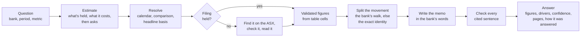

# Equity Researcher

A command-line agent that explains how an Australian bank's headline metric moved between a
reporting period and the same period a year earlier.

## Executive summary

Equity Researcher takes a bank, a reporting period and one of six metrics: net interest
margin, cash earnings, return on equity, CET1 ratio, credit impairment charge or
cost-to-income ratio. It returns the two reported figures, the movement between them, the
drivers of the movement with their contributions, a confidence score for each figure and
driver, and the filing page behind each number. All amounts are in Australian dollars.

A question goes through five stages:

1. **Resolve the question.** The bank is matched by ticker, name or brand, and the period is
   mapped to dates on that bank's own financial calendar. The comparison period is the same
   period one year earlier.
2. **Gather the evidence.** Filings come from the banks' websites and the ASX. 21 filings
   are downloaded and parsed in advance, and any other filing is located through the ASX
   announcements feed during the run. Each PDF is parsed into an outline, a register of
   tables with their columns mapped to periods, and text chunks for retrieval. Figures are
   extracted from table cells, converted to A$ millions and checked against accounting
   identities, then stored in a SQLite fact store with their source page and publication
   date.
3. **Attribute the movement.** If the bank publishes a walk (a bridge from one period to the
   next), it is read from a table, the text or a chart, and used only if its steps reconcile
   to the published movement. Otherwise the movement is split through the metric's
   accounting identity using exact Shapley values. Any unexplained residual is reported
   against a tolerance based on the printed precision.
4. **Write and check the explanation.** A language model (Claude Fable 5.1) writes a short
   memo from the computed drivers and the bank's own commentary, citing an evidence ID for
   each claim. A separate model call checks each cited sentence against its source, and
   sentences it can't support are removed.
5. **Score confidence.** Each figure and driver is scored from the evidence behind it: where
   it was printed, whether another source agrees, whether an accounting identity confirms
   it, and how it was read.

The model is used to find and read filings, interpret the bank's own walks and write the
memo. It reaches the filings through six read-only tools, while extraction, validation,
conflict handling, attribution and confidence scoring run as ordinary code. Before any model
call, the agent prints a cost estimate with a spending cap and waits for approval.

[LIVE_RUNS.pdf](LIVE_RUNS.pdf) shows ten recorded runs with an evaluation of each, and
[DESIGN.md](DESIGN.md) covers the architecture and the design decisions in more detail.

## Running it

You'll need macOS or Linux, Python 3.12, 3.13 or 3.14, `make`, `git`, and network access
to the banks' websites and the ASX. On Windows, see [Windows](#windows) below.

**1. Install.** Clone the repo, install it, and download the 21 bank filings it starts with
(about two minutes):

```bash
git clone https://github.com/DionMarks/equity_researcher.git
cd equity_researcher
make setup
make ingest
```

**2. Add your Anthropic API key.** Run this and paste the key when asked. Nothing is shown
on screen:

```bash
make key-set
```

On a Mac the key is kept in the keychain. Elsewhere it goes in a `.env` file in the repo
folder, which is gitignored. You can also create `.env` yourself with the single line
`ANTHROPIC_API_KEY=your-key`.

**3. Ask a question.** The agent shows its cost estimate and asks before spending anything:

```bash
make run ARGS='--bank NAB --period 1H26 --metric nim'
```

Answers print in the terminal and are saved under `runs/<run_id>/`. Add `--yes` to skip the
prompt, `--grant 12:3.00` to set your own cap in A$, or `--as-of YYYY-MM-DD` to answer as at
a past date.

### Ten examples

Run them one at a time, since each one asks before it spends.

| # | What it shows | Command |
| ---: | --- | --- |
| 1 | Margin, from the bank's written walk | `make run ARGS='--bank ANZ --period 1H26 --metric nim'` |
| 2 | Margin on the bank's headline basis | `make run ARGS='--bank WBC --period 1H26 --metric nim'` |
| 3 | Capital ratio, from two half-year walks | `make run ARGS='--bank CBA --period FY26 --metric cet1_ratio'` |
| 4 | The earnings bridge, line by line | `make run ARGS='--bank NAB --period 1H26 --metric cash_earnings'` |
| 5 | Collective and individual impairment charges | `make run ARGS='--bank WBC --period 1H26 --metric credit_impairment_charge'` |
| 6 | Return on equity, earnings against equity | `make run ARGS='--bank ANZ --period 1H26 --metric roe'` |
| 7 | A headline struck before tax | `make run ARGS='--bank Judo --period FY26 --metric headline_earnings'` |
| 8 | A brand, answered as its owner (Bendigo) | `make run ARGS='--bank Up --period FY25 --metric cost_to_income'` |
| 9 | A period not held, found on the ASX | `make run ARGS='--bank CBA --period FY24 --metric cash_earnings'` |
| 10 | A bank in no config file, found on the ASX | `make run ARGS='--bank BNK --period FY26 --metric nim'` |

The first seven answer from the filings `make ingest` downloads. The last three fetch what
they need from the ASX during the run. All ten together should cost roughly A$6 to A$15.

### Checks, evals and Docker

`make check` runs lint, type checks and 1,363 tests, and `make eval-dev` runs the 66
development cases. Neither needs a key. To run in Docker instead, which picks up your key
from the environment, `.env` or the keychain:

```bash
make docker-build
make docker-ingest
make docker-run ARGS='--bank NAB --period 1H26 --metric cet1_ratio'
```

### Windows

There are three ways to run it on Windows. CI runs the test suite and a smoke run of the
agent on Windows as well as Linux.

**WSL2.** This gives you a Linux environment, and the steps above then work unchanged. In
PowerShell, install Ubuntu:

```powershell
wsl --install -d Ubuntu-24.04
```

Then, in the Ubuntu terminal, install the tools and follow steps 1 to 3 above:

```bash
sudo apt update
sudo apt install -y python3.12-venv make git
```

**Native PowerShell.** No `make` is needed. Install Python 3.12, 3.13 or 3.14 from
python.org and Git for Windows, then run:

```powershell
git clone https://github.com/DionMarks/equity_researcher.git
cd equity_researcher
py -3.13 -m venv .venv
.venv\Scripts\python -m pip install -c constraints.txt -e ".[pdf,llm]"
.venv\Scripts\bankresearch ingest
notepad .env
```

In Notepad, add the line `ANTHROPIC_API_KEY=your-key`, then save and close. Ask a question
with:

```powershell
.venv\Scripts\bankresearch run --bank NAB --period 1H26 --metric nim
```

The ten examples work the same way, with `.venv\Scripts\bankresearch run` in place of
`make run ARGS='...'`. Use `py -3.12` or `py -3.14` if that's the version you have
installed, and Windows Terminal or PowerShell 7 for the best display of the tables.

**Docker Desktop.** With the key saved in `.env` as above, run from the repo folder in
PowerShell:

```powershell
docker build -t bankresearch .
docker run --rm -v bankresearch-data:/app/data bankresearch ingest
docker run --rm -it -v bankresearch-data:/app/data --env-file .env -e BANKRESEARCH_LLM_CONSENT=ask bankresearch run --bank NAB --period 1H26 --metric nim
```

### If something goes wrong

Each run reports what happened and what to do next. The common cases:

| Message | Fix |
| --- | --- |
| no API key was found | Run `make key-set`, or add `ANTHROPIC_API_KEY=your-key` to `.env` |
| the API didn't accept the key | Check it was pasted in full and is still active |
| the account has run out of credit | Top up in the Anthropic console |
| `the real-filing tests did not run` | Run `make ingest`, then `make check` |

`make help` lists the other commands, including the evaluation suites.

## How it solves the use case

- **Input.** A bank as a ticker, name or brand, a period such as `1H26` or `FY25`, and one
  of the six metrics. A brand is answered as the bank that owns it, so "Up" is answered as
  Bendigo and Adelaide Bank.
- **Comparison.** The same period a year earlier (1H26 against 1H25), on the bank's own
  financial calendar and headline basis. The movement is calculated from the two published
  figures rather than taken from the bank's commentary.
- **Currency and calendars.** Figures are converted to A$ millions before any arithmetic.
  Year ends come from config, so 1H26 covers October to March for Westpac and July to
  December for CBA.
- **Drivers.** The bank's own walk where one is published, otherwise the exact split of the
  metric's identity. Drivers sum to the movement, and any residual is shown.
- **Evidence and confidence.** Each figure and driver carries its document, page and table,
  plus a confidence score. When the evidence is incomplete, the agent abstains with a reason
  code.
- **New banks and periods.** A filing that isn't held locally is found in the ASX
  announcements feed and read during the run. A bank with no config is identified on the
  ASX, and what was learned about it is kept for next time.

## How it works, and why

Four design decisions shape the agent.

- **Tools.** The model has six read-only tools for navigating a filing, and each tool
  enforces the question's bank, period and date. Arithmetic, conflict handling, confidence
  and verification are code the model can't call. Data comes only from the banks' websites
  and the ASX, and when two sources disagree the difference is classified (rounding, units,
  basis, scope, pro forma, restatement, timing or unexplained) before either figure is used.
  The reason for this split is that a figure produced by a model can be wrong in ways the
  text doesn't show, such as a half-year figure read as a full year, whereas a figure
  produced by code can be traced to a table cell and checked.
- **Context.** Each filing is parsed once into an outline, period-mapped tables and
  searchable chunks. Retrieval narrows a question to a few pages, and the memo writer
  receives only the computed drivers and the bank's commentary, usually a few thousand
  tokens. Because figures come from the fact store rather than from retrieved text, a
  retrieval miss affects the explanation and not the numbers.
- **Memory.** The agent keeps validated figures with their publication dates, and what it
  learns about a new bank, such as its year end and how it labels rows. It doesn't reuse
  previous answers or another bank's figures, and every lookup is limited to what was
  published by the question's date. This stops figures from a later period leaking into an
  earlier question.
- **Evals.** 66 development cases with expected answers read from the cited pages, a frozen
  held-out set, robustness suites (removed evidence, questions dated before publication,
  injected conflicting figures) and calibration measured as expected calibration error
  (ECE). The suites check that the agent abstains when the evidence isn't there.

## Design



- **Tools:** `get_outline`, `search_docs`, `read_pages`, `get_table`, `read_chart` (a
  rendered page passed to the model's vision input) and `submit_reading_list`, which returns
  pages to read and never a figure.
- **Retrieval:** filings are parsed with PyMuPDF and pdfplumber into one chunk per table and
  prose chunks of about 800 tokens, searched with BM25 using metric synonym expansion and
  metadata filters. BM25 was chosen over embeddings because the questions depend on exact
  labels and figures. Pages that hold a bank's walk are located by their published opening
  and closing values, so an open-ended search only runs when that fails.
- **Inference:** Claude Fable 5.1 with extended thinking and reasoning effort set per step,
  JSON-schema structured outputs, prompt caching, one retry on Claude Opus 5.5, and a
  response cache that replays identical requests.
- **Attribution:** a bank's walk is accepted only if every step appears on the page and the
  steps reconcile to the published movement. Otherwise exact Shapley values, computed in
  rational arithmetic, split the identity.
- **Storage:** a SQLite fact store holding each validated figure with its basis, source page
  and publication date.
- **Testing:** 1,363 tests run in CI on Linux with Python 3.12, 3.13 and 3.14, and on
  Windows with Python 3.13, alongside a Docker build.

### Evaluation results

Measured on 66 development cases built from 21 filings (the four major banks' 2025 and 2026
results and Judo's 2026 annual report), and on recorded live runs:

| Measure | Result |
| --- | ---: |
| Development cases behaving as expected | 66 / 66 |
| Headline figures matching the expected answer in both periods | 55 / 55 |
| Drivers with the expected direction and size | 111 / 111 |
| Citations found on the page they cite | 717 / 717 |
| Expected calibration error, headline figures and drivers | 0.071 and 0.103 |
| Held-out cases | 15 / 15 |
| Robustness suites: removed evidence, early dates, injected conflicts | 139 / 139, 55 / 55, 106 / 106 |
| Citations found on their page across 25 audited live runs | 326 / 326 |

### Limitations and next steps

- The expected answers were read off the filings by an automated pass and haven't yet been
  reviewed by a person.
- The held-out set is small (5 accuracy cases), and the full development set hasn't been run
  live in one pass (about A$19).
- A filing layout the table reader hasn't seen can hide figures. The answer then lists which
  ones are missing.
- When a bank reports a measure on two bases, only the headline basis is shown. Westpac's
  1H26 margin fell 3 bps excluding notable items but rose 1 bp on a reported basis.
- A configured bank that renames a line item needs the new label added to its config.
- Quarterly updates, peer comparison, banks reporting in other currencies and a user
  interface are out of scope.
